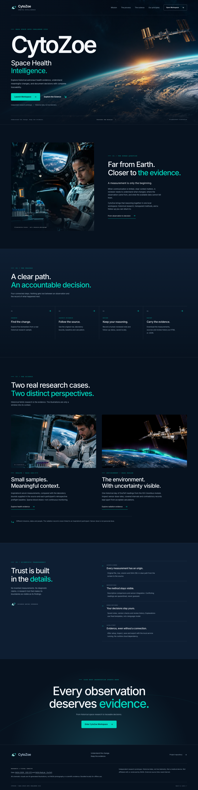
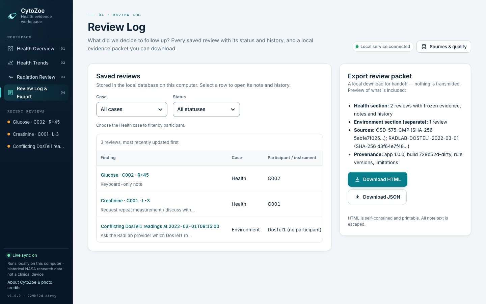
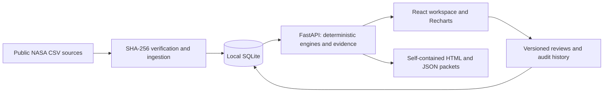

# CytoZoe

**Understand the change. Keep the evidence.**

An **offline-first astronaut health evidence and review workspace**, built for the **NASA Space Apps Challenge 2026**. CytoZoe uses authentic, historical NASA research measurements to help reviewers understand changes, inspect their sources, record follow-ups and export traceable evidence.

[**The challenge**](https://www.spaceappschallenge.org/2026/challenges/health-monitoring-software/) · [**Explore the interface**](#explore-cytozoe) · [**Run locally**](#quick-start) · [**3-minute judge walkthrough**](docs/DEMO_SCRIPT.md) · [**Source evidence**](docs/DATASETS.md)

> **Research demonstration — not a medical device.** No diagnosis, medical advice, illness prediction or live vital signs. Health and radiation are separate historical cases, **not person-matched**. The app uses deterministic explanations, **not a runtime AI model**.

## Explore CytoZoe



| **Health Overview** | **Radiation Review** |
|:---:|:---:|
|  |  |
| Compare five biomarkers with source laboratory ranges | Inspect recorded sensor observations and quarantined conflicts |

| **Health Trends** | **Review Log & Export** |
|:---:|:---:|
|  |  |
| Inspect historical visits and trace each value | Save follow-ups locally and export evidence packets |

*Screenshots show the real local application with historical NASA data and isolated QA review records. Landing artwork is AI-generated illustration, not NASA photography or scientific data.*

### A complete evidence workflow

**Inspect → compare → explain → record → reopen → audit → export.**

- **Grounded observations:** 140 biomarker measurements from 4 anonymised Inspiration4 participants, with visit-specific source ranges.
- **Transparent uncertainty:** 4 conflicting duplicate timestamps in a separate NASA ISS radiation record are preserved and excluded from calculations.
- **Auditable follow-up:** source-linked explanations, persistent review notes, versioned edits and HTML/JSON exports.
- **Autonomous by design:** core local workflows run without an internet connection after initial setup. The public Railway demo, if deployed, is intentionally **read-only**.

[Explore all features](docs/PRODUCT_FEATURES.md) · [View scientific data and exclusions](docs/DATASETS.md) · [Read verified test evidence](docs/TEST_REPORT.md)

---

## Why it matters

On a deep-space mission, the crew may have to review health information when Earth is delayed or unreachable. NASA's exploration-medicine work describes this need for independent access to health data and store-and-forward review ([NASA xEHR, 2023](https://ntrs.nasa.gov/citations/20230003216); [Earth-independent clinical decision support, 2024](https://www.nasa.gov/centers-and-facilities/ames/ames-science/ames-space-biosciences/a-clinical-decision-support-system-for-earth-independent-medical-operations/)).

A spreadsheet of measurements cannot show a reviewer:
- what changed;
- which source row supports a finding;
- where the uncertainty is;
- what follow-up was decided.

CytoZoe closes that review-workflow gap in one complete loop: **inspect → explain → save follow-up → reopen → export**.

| Challenge intent | What CytoZoe does | Honest boundary |
|---|---|---|
| Gather indicators | Imports two documented NASA CSVs locally, verified by SHA-256 | Historical data; no live sensors |
| Evaluate health | Personal preflight baseline, supplied lab ranges, actual sample history | Descriptive only; no diagnosis or severity score |
| Act on information | Saves notes and status with an audit trail; exports an HTML/JSON handoff packet | No automatic recommendation or transmission |
| Support autonomy | Every core operation runs with the internet disconnected after setup | Needs the local server process running |

## Key capabilities

- **Health comparisons:** participant baseline, original lab ranges, historical visit trends and source-row evidence.
- **Radiation quality review:** recorded DosTel1 replay with transparent quarantine of conflicting rows; estimates are **sensor dose only**, never a personal dose.
- **Review-to-handoff:** versioned notes, audit trail, stale-edit protection, cross-window synchronization and offline HTML/JSON export.
- **Deterministic evidence:** SHA-256 source verification and fixed explanation templates; no generative AI at runtime.
- **Full workflow:** five pages, three deterministic engines and locally reproducible source handling.

[Complete feature reference](docs/PRODUCT_FEATURES.md) · [API contract](docs/API_CONTRACT.md)

---

## Architecture



The browser renders backend measurements and comparisons. E1 validates provenance and quarantines conflicting source rows; E2 computes descriptive biomarker comparisons; E3 integrates accepted sensor intervals. Server-sent events deliver recorded replay and review synchronization. Health and environmental cases remain separate throughout evidence, reviews and exports.

## Quick start

Requirements: Python 3.11+ and Node.js 22.12+ (or another version supported by the pinned Vite release). Network access is needed **only once**, for dependencies and the one-time NASA data download.

### Easiest (any OS, from the project folder)
```sh
npm run dev     # first run auto-sets up venv, npm deps & NASA data, then starts API (:8000) + interface → http://127.0.0.1:5173
npm start       # demo / offline: built app on one port → http://127.0.0.1:8000
```
`npm run setup` runs the one-time setup only (`npm run dev -- --setup` forces it again). `npm run data` re-downloads and imports the NASA files. `npm test` runs the backend tests, typecheck and component tests; `npm run e2e` runs the browser tests.

### Windows (PowerShell)
```powershell
.\scripts\setup.ps1      # venv + backend deps, npm ci + build, fetch → verify → import NASA data
.\scripts\start.ps1      # http://127.0.0.1:8000
```

### macOS / Linux
```sh
sh scripts/build_local.sh
sh scripts/start.sh      # http://127.0.0.1:8000
```

### Manual steps (any OS)
```sh
python -m venv .venv && <activate it>
python -m pip install -e "./backend[dev]"
cd frontend && npm ci && npm run build && cd ..
python scripts/fetch_data.py --all            # one-time, allow-listed NASA HTTPS hosts only
python scripts/verify_data.py --strict        # SHA-256 + schema + counts
python scripts/import_data.py --all           # atomic, idempotent import into runtime/cytozoe.sqlite
uvicorn app.main:app --app-dir backend --host 127.0.0.1 --port 8000
```

Development with hot reload: run the uvicorn command above, then `cd frontend && npm run dev` (http://127.0.0.1:5173, which proxies `/api` to port 8000).

Once data is imported, **the raw CSVs are no longer needed**: the app reads only from the local SQLite database. The repository does not ship raw files. Running `fetch_data.py` recreates them byte-for-byte, and the manifest proves that by hash.

### Tests
```sh
# Run from the repository root after setup:
npm test                       # backend regression tests, TypeScript, then component tests
node tests/launcher/launcher.test.mjs
npm run e2e                    # full browser suite; installed Chrome/Edge required
# Set PW_CHANNEL=msedge on Windows if needed.
```
The real-data backend and E2E tests need `data/raw/` staged (`python scripts/fetch_data.py --all`). Without it they are **skipped, not faked**. See [docs/TEST_REPORT.md](docs/TEST_REPORT.md) for the latest run.


## NASA data and scientific boundaries

| Case | Authentic source | What the application uses |
|---|---|---|
| **Health** | NASA OSDR **OSD-575**, Inspiration4 (2021) | 4 anonymised participants × 7 visits × 5 blood biomarkers = **140 measurements** |
| **Environment** | NASA OSDR RadLab, ISS **DosTel1** (1 March 2022) | **1,202 rows**, including **8 quarantined conflicting rows** at 4 timestamps; **1,194 accepted** |

The datasets come from different missions, times and people. **They are never joined**, and the application makes no exposure–health causal claim. All raw-source hashes, exact columns, sample calculations, data-quality decisions, licensing notes and exclusions are retained in the [detailed scientific data record](docs/DATASETS.md).

[Source manifest](data/manifests/sources.json) · [Provenance](docs/SOURCES.md) · [Data dictionary](docs/DATA_DICTIONARY.md)

---

## Privacy and limitations

- Local startup binds to **127.0.0.1**; after setup the core application makes no external network requests.
- Source imports are SHA-256 checked; raw NASA downloads, SQLite review data and local notes are not committed.
- The exported evidence is descriptive research material, **not clinical advice or a flight-certified system**.
- Public Railway hosting is a separate **read-only** configuration; its working HTTPS deployment must be independently verified before being advertised.

[Security model](docs/SECURITY.md) · [Known limitations](docs/KNOWN_LIMITATIONS.md) · [Deployment instructions](docs/RAILWAY_DEPLOYMENT.md)

## Documentation

| Document | Purpose |
|---|---|
| [docs/BACKEND_RELEASE_REPORT.md](docs/BACKEND_RELEASE_REPORT.md) | Backend v3 milestones, test results, fixed defects, limits |
| [docs/API_CONTRACT.md](docs/API_CONTRACT.md) | Every endpoint, MissionBriefV1, error codes, provenance |
| [docs/RELEASE_CHECKLIST.md](docs/RELEASE_CHECKLIST.md) | Fresh setup → journey → offline → submission checks |
| [docs/REBUILD_BASELINE.md](docs/REBUILD_BASELINE.md) | Audit findings before the backend rebuild |
| [docs/IMPLEMENTATION_STATUS.md](docs/IMPLEMENTATION_STATUS.md) | P0/P1 requirement ledger |
| [docs/TEST_REPORT.md](docs/TEST_REPORT.md) | Commands, results, visual & accessibility findings |
| [docs/ARCHITECTURE.md](docs/ARCHITECTURE.md) | Engines, API, schema, data flow |
| [docs/SOURCES.md](docs/SOURCES.md) / [docs/DATA_DICTIONARY.md](docs/DATA_DICTIONARY.md) | Provenance and fields |
| [docs/KNOWN_LIMITATIONS.md](docs/KNOWN_LIMITATIONS.md) | What CytoZoe cannot do |
| [docs/DEMO_SCRIPT.md](docs/DEMO_SCRIPT.md) | Three-minute judge demo |
| [docs/SUBMISSION.md](docs/SUBMISSION.md) | Space Apps submission text and checklist |
| [docs/SECURITY.md](docs/SECURITY.md) | Threat model and safeguards |

## Credits

Team CytoZoe (NASA Space Apps 2026). Data: NASA OSDR (OSD-575) and NASA OSDR RadLab (DosTel1). Development used AI coding assistants including Claude Code and OpenAI Codex. The premium landing illustrations are AI-generated artwork, not NASA photography or source evidence. The delivered app itself uses no AI model at runtime. Check the 2026 Space Apps AI-disclosure rules before submitting.

Code licence: see [LICENSE](LICENSE). NASA data remain subject to their providers' terms.

---

## Verification status

The latest **reported** repository release checks are dated **15 November 2026**: production build and TypeScript passed, **61 backend tests passed**, **25 Chrome browser tests passed**, and both NASA source hashes were verified. **Frontend component tests were blocked during worker startup**; final manual 200% zoom and assistive-technology verification remain incomplete. These are historical reported results, **not new tests run for this README change**.

[Full test report and logs](docs/TEST_REPORT.md) · [Implementation report](docs/FINAL_IMPLEMENTATION_REPORT.md) · [Release checklist](docs/RELEASE_CHECKLIST.md)

## Public demo

CytoZoe includes a documented Railway deployment path, but **a working public HTTPS link is not yet verified in the committed release evidence**. Until verified, use the [local quick start](#quick-start) and [judge demo script](docs/DEMO_SCRIPT.md). The public deployment is intentionally read-only; save/edit demonstrations use local mode.

[Railway deployment guide](docs/RAILWAY_DEPLOYMENT.md) · [Submission checklist](docs/SUBMISSION.md)
