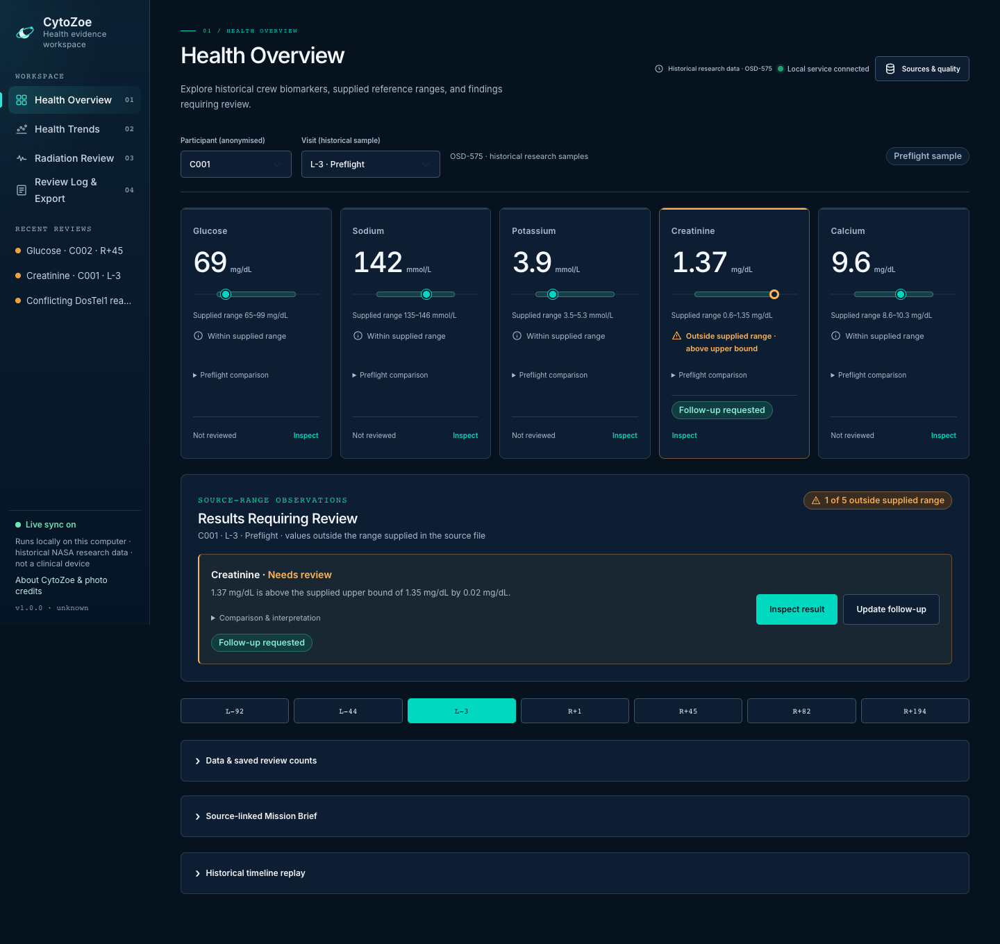
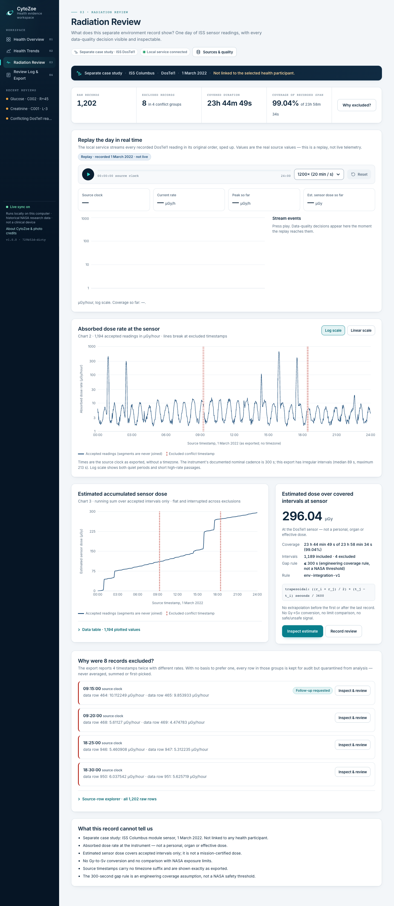
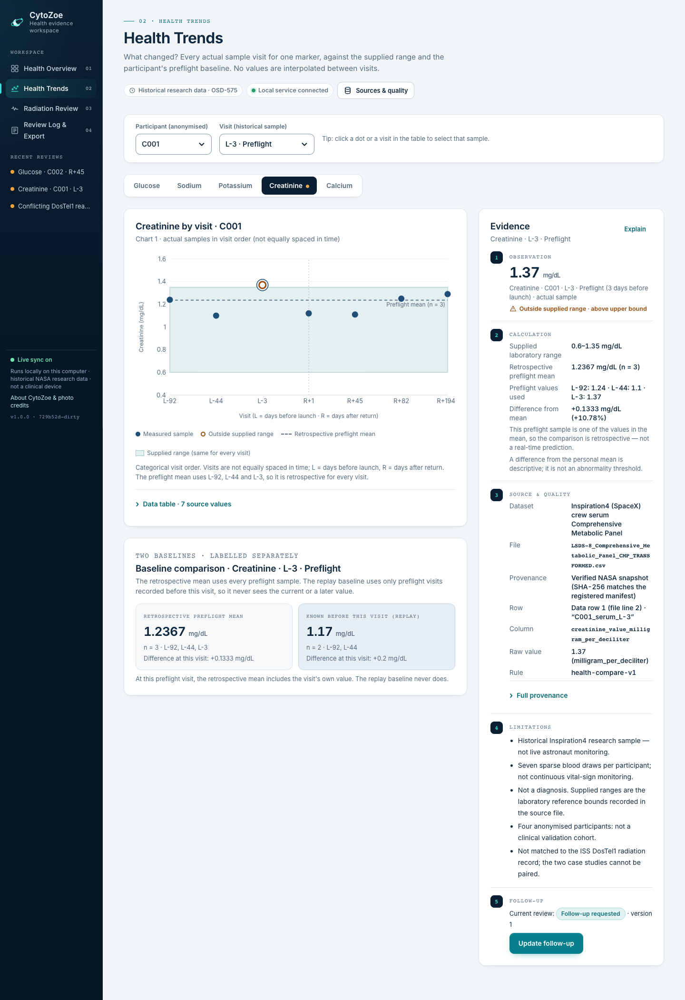
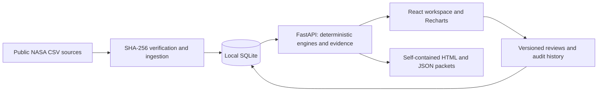

# CytoZoe — Evidence-Driven Space Health Intelligence

**Team CytoZoe (City University Malaysia) · NASA Space Apps Kuala Lumpur 2026**

**Challenge:** [Create Health Monitoring Software for Astronauts on Space Missions](https://www.spaceappschallenge.org/2026/challenges/health-monitoring-software/)

CytoZoe is a local-first astronaut health evidence and review workspace: understand changes in historical NASA measurements, inspect their sources, and record and export traceable follow-ups.

- **Live Application:** [https://cytozoe-production.up.railway.app](https://cytozoe-production.up.railway.app)
- **30-Second Pitch Video:** [Watch the pitch](https://youtu.be/jRwjF0Jq_pA)
- **5-Minute Demo & Final Report:** [View the demo and report](https://drive.google.com/file/d/1ekSjXvieL-cMzicCKPdibMAkP8WiNT2T/view?usp=sharing)

> **Research demonstration, not a medical device.** No diagnosis, illness prediction or live vital signs. Health and radiation remain separate historical cases. Explanations are deterministic; no AI model runs in the application.

## Application gallery

### Landing


| **Health Overview** | **Radiation Review** |
|:---:|:---:|
|  |  |
| Compare five biomarkers with source laboratory ranges | Inspect recorded sensor observations and quarantined conflicts |

| **Health Trends** | **Review Log & Export** |
|:---:|:---:|
|  |  |
| Inspect historical visits and trace each value | Save follow-ups locally and export evidence packets |

*Screenshots show the real local application with historical NASA data and isolated QA review records. Landing artwork is AI-generated illustration, not NASA photography or scientific data.*

## Problem and solution

On a deep-space mission, the crew may have to review health information when Earth is delayed or unreachable. NASA's exploration-medicine work describes this need for independent access to health data and store-and-forward review ([NASA xEHR, 2023](https://ntrs.nasa.gov/citations/20230003216); [Earth-independent clinical decision support, 2024](https://www.nasa.gov/centers-and-facilities/ames/ames-science/ames-space-biosciences/a-clinical-decision-support-system-for-earth-independent-medical-operations/)).

A spreadsheet of measurements cannot show a reviewer:
- what changed;
- which source row supports a finding;
- where the uncertainty is;
- what follow-up was decided.

CytoZoe closes that review-workflow gap in one complete loop: **inspect → compare → explain → record → reopen → export**.

| Challenge intent | What CytoZoe does | Honest boundary |
|---|---|---|
| Gather indicators | Imports two documented NASA CSVs locally, verified by SHA-256 | Historical data; no live sensors |
| Evaluate health | Personal preflight baseline, supplied lab ranges, actual sample history | Descriptive only; no diagnosis or severity score |
| Act on information | Saves notes and status with an audit trail; exports an HTML/JSON handoff packet | No automatic recommendation or transmission |
| Support autonomy | Every core operation runs with the internet disconnected after setup | Needs the local server process running |

## Key features and engineering differentiators

- **Five screens:** Landing, Health Overview, Health Trends, Radiation Review, and Review Log & Export.
- **Three charts:** blood biomarkers by visit, sensor dose rate, and estimated accumulated sensor dose.
- **Three deterministic engines:** E1 verifies SHA-256 provenance, validates schemas and quarantines conflicts; E2 computes baseline comparisons, deltas and source-range status; E3 integrates accepted sensor intervals.
- **Historical replay over SSE:** radiation observations stream in source order; timeline replay steps through seven actual blood draws. Both are recorded historical replay, never live telemetry.
- **Cross-tab SSE synchronization:** saved reviews update other windows; optimistic versioning returns HTTP 409 for stale edits and preserves unsaved drafts.
- **Traceable handoff:** persistent notes, audit history, fixed source-bound explanations, and self-contained HTML/JSON exports with source hashes and limitations.
- **Local autonomy:** core workflows work offline after setup while the local server is running. The public Railway demo is read-only; save/edit demonstrations use local mode.

[Complete feature reference](docs/PRODUCT_FEATURES.md) · [API contract](docs/API_CONTRACT.md)

## NASA scientific datasets and provenance

| Case | Source and sample counts | Units |
|---|---|---|
| Health | [NASA OSDR OSD-575](https://osdr.nasa.gov/bio/repo/data/studies/OSD-575), Inspiration4 (2021): 4 anonymised participants × 7 visits = 28 samples; 5 biomarkers = 140 measurements | Glucose, creatinine and calcium: mg/dL; sodium and potassium: mmol/L |
| Environment | [NASA RadLab DosTel1](https://visualization.osdr.nasa.gov/radlab/gui/knowledgebase/DosTel1), ISS Columbus, 1 March 2022: 1,202 source rows; 1,198 unique timestamps; 1,194 accepted rows | Absorbed dose rate: µGy/hour; integrated sensor dose: µGy |

Pinned source SHA-256 hashes:

- **OSD-575** (`LSDS-8_Comprehensive_Metabolic_Panel_CMP_TRANSFORMED.csv`): `5eb1e7f025dd8443a9e70111e62bc32afae3432753024489c5c013e401d709d9`
- **DosTel1** (`radlab_DosTel1_2022-03-01.csv`): `d3f64e7f483c3ae2f08bb5e6633bae5091e661a988c434205ce6bb78c050f7e1`

Four conflicting duplicate timestamps produce **8 quarantined rows**, preserved for audit and excluded without averaging or selecting a preferred value. The estimate is **296.04 µGy** at the sensor over **23 h 44 min 49 s**, covering **99.04%** of the recorded span: 1,189 included intervals and 4 excluded intervals. It is not personal, organ or effective dose; no Gy-to-Sv conversion is made.

Non-matched candidate datasets GLDS-174 and BIDMC were excluded to preserve scientific validity.

OSD-575 and DosTel1 come from different missions, times and people, so they are **never joined**: the API rejects cross-case linkage with `CROSS_CASE_LINK_REJECTED`. No exposure–health causal claim is made.

[Detailed dataset methods and licensing](docs/DATASETS.md) · [Source manifest](data/manifests/sources.json) · [Provenance](docs/SOURCES.md) · [Data dictionary](docs/DATA_DICTIONARY.md)

## Architecture and technology stack

**React 19 + TypeScript + Vite + Recharts · FastAPI + Pydantic + pandas · SQLite WAL with versioned migrations.** The API serves the built interface from one origin; fonts are bundled locally.



The browser renders backend measurements and comparisons. E1 validates provenance and quarantines conflicting source rows; E2 computes descriptive biomarker comparisons; E3 integrates accepted sensor intervals. Server-sent events deliver recorded replay and review synchronization. Health and environmental cases remain separate throughout evidence, reviews and exports.

## Quick start

Requirements: Python 3.11+ and Node.js 22.12+ (or another version supported by the pinned Vite release). Network access is needed **only once**, for dependencies and the one-time NASA data download.

### Easiest (any OS, from the project folder)
```sh
npm run dev     # first run auto-sets up venv, npm deps & NASA data, then starts API (:8000) + interface → http://127.0.0.1:5173
npm start       # demo / offline: built app on one port → http://127.0.0.1:8000
```
`npm run setup` runs the one-time setup only (`npm run dev -- --setup` forces it again). `npm run data` re-downloads and imports the NASA files. `npm test` runs the backend tests, typecheck and component tests; `npm run e2e` runs the browser tests.

### Windows (PowerShell)
```powershell
.\scripts\setup.ps1      # venv + backend deps, npm ci + build, fetch → verify → import NASA data
.\scripts\start.ps1      # http://127.0.0.1:8000
```

### macOS / Linux
```sh
sh scripts/build_local.sh
sh scripts/start.sh      # http://127.0.0.1:8000
```

### Manual steps (any OS)
```sh
python -m venv .venv && <activate it>
python -m pip install -e "./backend[dev]"
cd frontend && npm ci && npm run build && cd ..
python scripts/fetch_data.py --all            # one-time, allow-listed NASA HTTPS hosts only
python scripts/verify_data.py --strict        # SHA-256 + schema + counts
python scripts/import_data.py --all           # atomic, idempotent import into runtime/cytozoe.sqlite
uvicorn app.main:app --app-dir backend --host 127.0.0.1 --port 8000
```

Development with hot reload: run the uvicorn command above, then `cd frontend && npm run dev` (http://127.0.0.1:5173, which proxies `/api` to port 8000).

Once data is imported, **the raw CSVs are no longer needed**: the app reads only from the local SQLite database. The repository does not ship raw files. Running `fetch_data.py` recreates them byte-for-byte, and the manifest proves that by hash.

### Tests
```sh
# Run from the repository root after setup:
npm test                       # backend regression tests, TypeScript, then component tests
node tests/launcher/launcher.test.mjs
npm run e2e                    # full browser suite; installed Chrome/Edge required
# Set PW_CHANNEL=msedge on Windows if needed.
```
The real-data backend and E2E tests need `data/raw/` staged (`python scripts/fetch_data.py --all`). Without it they are **skipped, not faked**. See [docs/TEST_REPORT.md](docs/TEST_REPORT.md) for the latest run.


## Technical documentation

| Document | Purpose |
|---|---|
| [Architecture](docs/ARCHITECTURE.md) | Engines, schema and data flow |
| [API contract](docs/API_CONTRACT.md) | Endpoints, errors and provenance |
| [Datasets](docs/DATASETS.md) | Scientific methods, counts and exclusions |
| [Sources](docs/SOURCES.md) / [Data dictionary](docs/DATA_DICTIONARY.md) | Provenance and fields |
| [Test report](docs/TEST_REPORT.md) | Historical verification evidence and raw logs |
| [Security](docs/SECURITY.md) | Threat model and safeguards |
| [Known limitations](docs/KNOWN_LIMITATIONS.md) | Scientific and verification boundaries |
| [Release checklist](docs/RELEASE_CHECKLIST.md) | Reproducible release checks |
| [Railway deployment](docs/RAILWAY_DEPLOYMENT.md) | Read-only public hosting |

## Project team, credits and licensing

**Team CytoZoe — City University Malaysia (NASA Space Apps Kuala Lumpur 2026)**

- Mohamed Yuusuf
- Muhammad Danish bin Shaharin
- Rashid Riyadh
- Zineb Afqir
- Muhyadiin Muhumed Jama
- Mustafe Abdurazak Omar

Scientific data: [NASA OSDR OSD-575](https://osdr.nasa.gov/bio/repo/data/studies/OSD-575) and [NASA OSDR RadLab DosTel1](https://visualization.osdr.nasa.gov/radlab/gui/knowledgebase/DosTel1); NASA data remain subject to their providers' terms.

Development used AI coding assistants including Claude Code and OpenAI Codex, and the landing illustrations are AI-generated artwork rather than NASA photography or scientific evidence.

Code licence: see [LICENSE](LICENSE).

## Verified release status

The recorded **15 November 2026** release checks report:

| Check | Verified result |
|---|---|
| Production build and strict TypeScript | Passed |
| Backend regression suite | 61 passed (see historical logs for collection and skips) |
| Chrome browser E2E suite | 25 passed |
| NASA SHA-256 source verification | Both pinned datasets passed |

These are preserved historical results, not application tests rerun for this documentation-only release. See the [full test report and raw logs](docs/TEST_REPORT.md) and [known limitations](docs/KNOWN_LIMITATIONS.md) for component-worker startup blocks and accessibility scope limits.

## Live Railway demo

**[Open CytoZoe](https://cytozoe-production.up.railway.app)** — HTTPS endpoints verified on **16 November 2026**:

- [`/api/healthz`](https://cytozoe-production.up.railway.app/api/healthz): HTTP 200, `status: alive`.
- [`/api/readyz`](https://cytozoe-production.up.railway.app/api/readyz): HTTP 200, `ready: true`, `state: READY`; database, migrations, both verified datasets and frontend build all pass.

The public demo is read-only. Use the [local quick start](#quick-start) for persistent review creation, editing and offline export demonstrations.

[Railway deployment guide](docs/RAILWAY_DEPLOYMENT.md)
